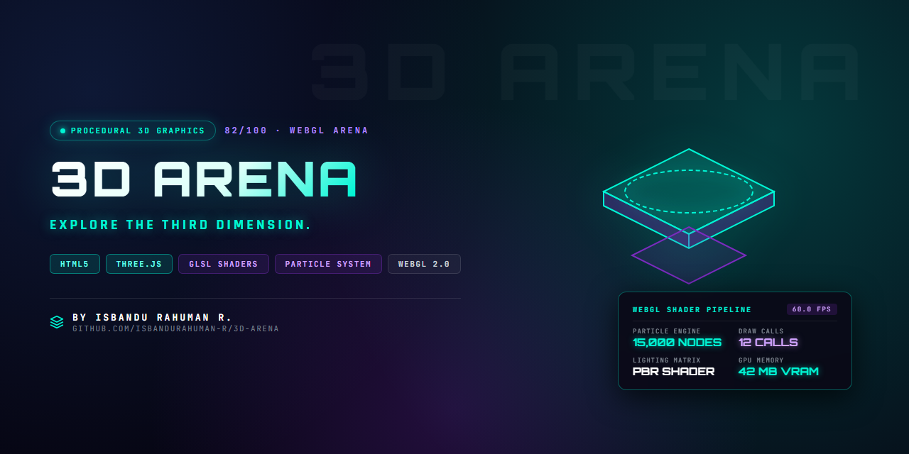

<p align="center">
  
</p>

# ◈ Eclipse Sanctum — 3D Fantasy Boss Rush

## ◆ About the Project
Eclipse Sanctum is a real-time third-person 3D action boss rush game built entirely within the browser using Three.js and WebGL. Players control an armored knight atop a suspended gothic arena beneath an eclipse, engaging in combat encounters against three multi-phase boss adversaries.

## ❖ Key Features
- Procedural 3D character and creature models constructed with articulated procedural skeletal animation.
- Souls-like action combat engine featuring 3-hit combos, charged heavy attacks, directional dodge rolls with invulnerability frames, timed parries, and spellcasting.
- Three unique boss encounters with distinct attack telegraphs, weak points, and second-phase transformations.
- 100% procedural sound synthesis engine built with the Web Audio API for metal impacts, dragon roars, and ambient atmospheric effects.
- Dual input control scheme supporting keyboard/mouse controls and a mobile touchscreen virtual analog stick.

## ⬢ Technologies Used
- Three.js (r128)
- WebGL & GLSL Shaders
- HTML5 Canvas
- Tailwind CSS
- Web Audio API

## § Requirements
- Modern web browser with WebGL support

## ▲ Installation & Execution
```bash
# Serve locally using Python
python -m http.server 3000

# Or serve using Node.js
npx serve .
```
Open `http://localhost:3000` in your web browser.

## ※ Developer
Developer: ISBANDU RAHUMAN R  
GitHub: https://github.com/ISBANDURAHUMAN-R
